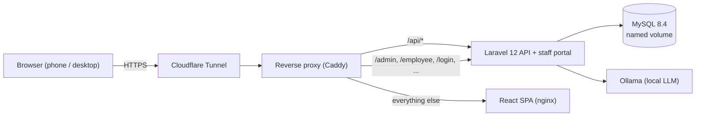

# RGV Multi-Tech Services

A technology-integrated operations system for a multi-tech services business: a REST API, a
separate web client, a server-rendered staff portal, a relational database, and a locally hosted
AI assistant.

- **Live URL:** <!-- TODO(team): add the public HTTPS address -->
- **API docs:** <!-- TODO(team): https://<live-url>/api/docs --> (Swagger UI, served at `/api/docs`)
- **Team:** <!-- TODO(team): names and roles (max 3) -->
- **Section:** <!-- TODO(team): section -->
- **Adviser/Instructor:** Rinante M. Buntod

> Items marked `TODO(team)` cannot be filled in from the repository alone and must be supplied by
> the team before submission.

## Features (by role)

**Public (no account)**

- Browse available inventory and resolve a physical item from its printed QR code.
- Submit a service booking and track it by reference number.

**Employee** (`employee` role)

- Sign in with a Sanctum bearer token; MFA supported.
- Dashboard of own borrow requests and inventory availability.
- Search and filter inventory; create borrow requests; cancel pending requests.
- Return borrowed items with recorded condition.

**Administrator** (`admin` role)

- Full CRUD over inventory items and borrow requests through the REST API.
- Approve, reject, and complete borrow requests and bookings.
- User management, reports, audit log, backups, import/export.
- AI-assisted insights over aggregated report data, with a deterministic fallback.

Role checks are enforced **on the server** for every protected endpoint. The client only decides
which controls to render.

## Architecture



The reverse proxy serves the SPA under **`/app`** and forwards everything else to Laravel, so every
pre-existing URL (`/`, `/booking`, `/login`, `/admin`, `/employee`, …) keeps its current behaviour.
Only the proxy publishes ports; the database and the AI service are reachable only inside the
Compose network. The browser never talks to the database or to Ollama directly.

- **Client application:** `Frontend/app` — React 18 + TypeScript, served at `/app`. All data comes from `/api/v1`.
- **Staff portal:** Laravel Blade views served by the same API container (retained, not replaced).
- **Mobile client:** `Frontend/mobile` — Flutter, employee workflows.

## Tech stack

| Layer | Choice |
|---|---|
| Client | React 18, TypeScript, Vite, React Router, TanStack Query, Tailwind CSS |
| Backend | Laravel 12 (PHP 8.2+), Sanctum tokens, Spatie permissions |
| Database | MySQL 8.4, Eloquent migrations and seeders |
| Integration | Ollama (open-weight model) for the report assistant |
| Reverse proxy | Caddy 2 |
| Containers | Docker Engine + Docker Compose |
| CI/CD | GitHub Actions + self-hosted runner |
| Tests | PHPUnit, Vitest + Testing Library, Flutter test |

## Run locally

### Docker (full stack)

```bash
cp .env.example .env          # Compose reads this file for interpolation
cp Backend/.env.example Backend/.env
docker compose up -d --build
docker compose exec app php artisan key:generate
docker compose exec app php artisan migrate --force
docker compose exec app php artisan db:seed
docker compose exec ollama ollama pull qwen3:1.7b
```

The system is then reachable at `http://localhost` (staff portal) and `http://localhost/app/`
(the web client).

> Compose interpolation reads the repository-root `.env`. `Backend/.env` is loaded into the
> container as application configuration but does **not** satisfy `${...}` substitution.

### Native development

```bash
cd Backend && composer install && composer run dev     # API + Blade on :8000, reachable from the LAN
cd Frontend/app && npm ci && npm run dev               # SPA on :5174 (proxies /api to :8000)
cd Frontend/mobile && flutter pub get
```

### Connecting the Flutter app

The native app talks only to Laravel. `composer run dev` starts the API on
port 8000 and a local-network discovery responder. A physical phone discovers
the current API address automatically when it shares a Wi-Fi/LAN with the
computer. On Windows, run `scripts/allow-mobile-api-local-subnet.ps1` once in
an Administrator PowerShell session. Its firewall rules use `LocalSubnet`, so
they continue to cover the current network after the computer changes Wi-Fi.

```bash
# Android emulator (10.0.2.2 is the host machine)
flutter run --dart-define=API_BASE_URL=http://10.0.2.2:8000

# Physical device on the same Wi-Fi/LAN (automatic discovery)
cd Frontend/mobile && flutter run

# Deployed build (HTTPS is required in release mode)
flutter build apk --dart-define=API_BASE_URL=https://your-domain.example
```

Local discovery requires the phone and computer to be on the same network and
that network to permit device-to-device traffic. Release APKs use a stable
HTTPS API URL instead of local discovery.

**Employee flow:** an administrator creates the employee at `/admin/users/create`, then that
employee signs into the app with the same email and password. Laravel is the only source of
identity — Supabase is not used.

### MySQL

Set up a local database before migrating:

```bash
mysql -u root -e "CREATE DATABASE rgv_system CHARACTER SET utf8mb4 COLLATE utf8mb4_unicode_ci;"
cd Backend && php artisan migrate --seed
```

Configure `DB_HOST`, `DB_PORT`, `DB_DATABASE`, `DB_USERNAME` and `DB_PASSWORD` in `Backend/.env`.

## Test

```bash
# Backend (REST API + portal)
cd Backend && php artisan test

# SPA client
cd Frontend/app && npm run lint && npm run test && npm run build

# Blade asset pipeline
cd Frontend/web && npm run build

# Flutter
cd Frontend/mobile && flutter analyze && flutter test
```

Backend tests run against in-memory SQLite, so they never touch the MySQL database configured in
`Backend/.env`. Because SQLite accepts some SQL that MySQL rejects, CI also runs `migrate` and
`db:seed` against a real MySQL service (`migrate-check` job) before any deploy.

## Deployment

Every merge to `main` triggers `.github/workflows/ci-cd.yml`:

1. `backend` — PHP syntax, Pint on the API modules, PHPUnit with a 60% coverage gate.
2. `frontend-spa` — ESLint, Vitest, production build.
3. `frontend-assets`, `mobile` — asset build and Flutter analyze/test.
4. `compose` — Compose configuration validation and container build.
5. `deploy` — on a self-hosted runner: compose rebuild, migrations, then a health check that
   requires `/api/health` to report the new commit ID.

Hosting uses a self-hosted server plus a Cloudflare Tunnel for a public HTTPS address. Runbooks:
[docs/deployment.md](docs/deployment.md), [docs/cicd-runbook.md](docs/cicd-runbook.md).

## Demo accounts

Sample data only. Created by `php artisan db:seed` when the `DEMO_*` variables are set:

| Role | Email | Password |
|---|---|---|
| Administrator | <!-- TODO(team): demo admin email --> | <!-- TODO(team): demo admin password --> |
| Employee | <!-- TODO(team): demo employee email --> | <!-- TODO(team): demo employee password --> |

## API

- Base path: `/api/v1`. Resources are plural and hyphenated.
- Authentication: `Authorization: Bearer <token>` from `POST /api/v1/auth/login`.
- Errors share one envelope: `{"error": {"code", "message", "details"}}`.
- List endpoints accept `page`, `limit`, `sort`, `q` and return `meta` with `total` and
  `total_pages`.
- Interactive reference: `/api/docs` (Swagger UI). Machine-readable:
  [docs/api/openapi.yaml](docs/api/openapi.yaml).
- Health: `GET /api/health` → status, version, commit ID, database connectivity.

## Documentation

| Document | Location |
|---|---|
| System documentation (D1) | [docs/01-system-documentation](docs/01-system-documentation) |
| User manual (D2) | [docs/02-user-manual](docs/02-user-manual) |
| API reference (D3) | [docs/03-api/openapi.yaml](docs/03-api/openapi.yaml) |
| Research paper (D4) | [docs/04-paper](docs/04-paper) |
| Architecture | [docs/architecture.md](docs/architecture.md) |
| Deployment and recovery | [docs/deployment.md](docs/deployment.md) |
| CI/CD runbook | [docs/cicd-runbook.md](docs/cicd-runbook.md) |
| Backup/restore drill record | [docs/evaluation/backup-restore-drill.md](docs/evaluation/backup-restore-drill.md) |
| Branch ruleset | [.github/rulesets/protect-main.json](.github/rulesets/protect-main.json) |
| Lint baseline | [docs/lint-baseline.md](docs/lint-baseline.md) |
| ITSD 85 compliance matrix | [docs/ITSD85-final-project-compliance.md](docs/ITSD85-final-project-compliance.md) |

## Operations scripts

| Script | Purpose |
|---|---|
| `scripts/backup.sh` | Consistent MySQL dump outside the database volume |
| `scripts/restore.sh` | Restore into a separate database and verify row counts |
| `scripts/setup-branch-ruleset.sh` | Apply the committed `main` branch ruleset |

## License and credits

MIT License — see [LICENSE](LICENSE).

Third-party components keep their own licenses: Laravel, React, MySQL, Caddy, Ollama and the
selected open-weight model. AI assistance used while developing this system is declared in the
acknowledgement sections of the system documentation and the research paper.
