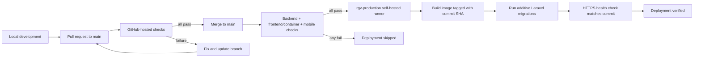

# RGV CI/CD Runbook

This runbook adapts the ITSD 85 CI/CD lab to the existing Laravel, Supabase PostgreSQL, Ollama, Caddy, and Flutter project. Supabase PostgreSQL is the shared production database; the deployment host runs Laravel and runtime services. Pull request CI runs on GitHub-hosted runners; only successful pushes to `main` reach the self-hosted deployment runner.

## Pipeline



CI jobs use GitHub-hosted Linux machines. The production runner connects outbound to GitHub, so the deployment server does not need a public SSH endpoint for Actions. Only Caddy publishes application web ports; Ollama remains on the private Compose network and Laravel reaches Supabase PostgreSQL over TLS.

## Required GitHub and server setup

1. Provision a Linux deployment host with Docker Engine and the Docker Compose v2 plugin. Configure DNS/TLS or an operator-managed HTTPS tunnel for the hostname.
2. Create a dedicated, unprivileged deployment account. Give it Docker access and install the GitHub Actions runner as a service under that account. Register labels `self-hosted`, `linux`, and `rgv-production`; use the current runner download/configuration commands from the repository's GitHub Actions settings. Never store the one-time registration token in the repository.
3. Provision the deployment checkout and private `.env` on the host. Set a unique `APP_KEY`, Supabase connection values from Dashboard > Connect, `APP_ENV=production`, `APP_DEBUG=false`, and correct `APP_URL`/`APP_DOMAIN`. Confirm the host can run `docker compose config -q` before enabling deployments.
4. In GitHub, create the `production` environment and add `APP_DOMAIN` as an environment variable. Keep runtime secrets in the host's `.env`; they are not CI variables.
5. Protect `main`: require pull requests, block force pushes, and require the `backend`, `frontend`, and `mobile` check jobs. Deployment is not a required PR check because it is only eligible after merge.
6. Limit repository write access to trusted maintainers. On a public repository, require approval for external-contributor workflows. The workflow does not schedule PR jobs on the self-hosted production runner.
7. Confirm the runner is `Idle` in GitHub and returns to `Idle` after the host reboots. Use Actions Runner `v2.327.1` or later for the Node 24 based checkout/setup actions in `.github/workflows/ci-cd.yml`.

## Local checks before a pull request

Run from the repository root:

```powershell
composer install
php artisan test
npm.cmd ci
npm.cmd run build
cd mobile
flutter pub get
dart format --output=none --set-exit-if-changed lib test
flutter analyze
flutter test
```

Use the PHP syntax and scoped Pint checks listed in the backend job in `.github/workflows/ci-cd.yml`; a full-repository Pint run currently reports pre-existing style findings outside that scoped list. The GitHub backend job measures coverage with PCOV and enforces 60%. The frontend job validates Compose configuration and builds the production Docker image. The Flutter job runs format, analyzer, and tests. The deploy job has all three jobs as dependencies; any failure prevents deployment.

## Verify the end-to-end behavior

Do these checks only after the branch rules, runner, environment, and deployment host are ready. Do not merge a deliberately broken test branch.

| Check | Safe procedure | Expected evidence | Actual result |
|---|---|---|---|
| A — successful release | Make a harmless documentation or UI text change on a feature branch, open a PR, wait for checks, then merge. | PR checks pass; deploy job runs only on the resulting `main` push; `/api/health` returns `status: ok` and the exact 40-character commit SHA. | Record run URL, SHA, elapsed time, screenshot. |
| B — failure blocks release | On a disposable feature branch, temporarily add a test that fails; push and open a PR. Do not merge. Remove/revert the test afterward. | Backend check fails, branch rule blocks merge, no deploy job runs, and live `/api/health` still reports the previous SHA. | Record run URL, previous SHA, screenshot. |
| C — rollback | Merge a harmless but intentionally incorrect display change through PR, verify it deploys, then create a revert PR and merge after checks pass. | Revert deploy succeeds; content is restored; health reports the new revert SHA. | Record both run URLs, old/new SHAs, rollback elapsed time. |

Optional emergency image rollback: list tags with `docker image ls rgv-system-app`, then from the same deployment checkout/Compose project set `APP_COMMIT` to a known healthy commit SHA and run `docker compose up -d --no-build app`. Confirm `/api/health` reports that SHA. This only rolls back the app container. Database migrations are not reversed, so use only when the prior app is compatible with the current schema. Follow with a reviewed Git revert PR.

## Results to retain for the final report

| Measure | How to measure | Result |
|---|---|---|
| Push-to-live time | Merge time to successful health-check completion, from Actions timestamps | Not measured in this repository audit |
| Successful deploys | Count successful main deployment runs | Not verified; GitHub Actions access was unavailable |
| Blocked failing changes | Count failed required checks with no merge/deploy | Not performed |
| Rollback time | Start of revert/rollback action to verified healthy response | Not measured |
| Health/commit evidence | Save JSON response and compare `commit` to GitHub main SHA | Not verified; public deployment URL unavailable |

Do not fill results with estimates. Capture real run links, timestamps, commit IDs, and screenshots after the deployment is configured.

## Guide questions

1. **CI, delivery, and deployment:** Continuous Integration automatically checks code changes. Continuous Delivery keeps a verified version ready to release. Continuous Deployment automatically releases each qualifying change. This workflow performs CI for PRs and pushes, then automatically deploys a successful push to `main` when the production runner and environment are configured.
2. **Why `needs`:** The deploy job lists backend, frontend, and mobile checks in `needs`. GitHub skips deployment if any dependency fails or is cancelled, providing a quality gate before production changes.
3. **Server behind NAT:** The self-hosted Actions runner starts an outbound connection to GitHub and polls for assigned work. GitHub does not need to initiate an inbound connection to the server.
4. **Why `npm ci`:** It installs the exact dependency tree recorded in `package-lock.json` and fails if the lockfile disagrees with `package.json`, reducing CI/local drift.
5. **Commit SHA as version:** It identifies precisely which source revision produced the deployed response and provides an immutable image tag for selecting a previous application build.
6. **Rollback options:** A revert PR is the normal auditable path and automatically reruns checks/deployment. Reusing a previous tagged image is faster for an emergency, but does not undo database migrations and must be schema-compatible.
7. **Self-hosted runner risks:** Jobs can execute repository code with the runner account's host access. Keep untrusted PRs off that runner, require approvals for external contributions, restrict write access, use a dedicated low-privilege account, and protect `main` with required checks.
8. **Free tooling:** GitHub Actions hosted runners provide CI for public repositories within GitHub's current policy; a self-hosted runner uses the team's own Linux host for deployment. Docker Compose, Laravel, PostgreSQL, Caddy, and the local Ollama integration are open-source components. Confirm current account/service terms before representing a hosting setup as zero-cost.

## Evidence checklist

- [ ] Green PR checks for a normal change.
- [ ] Failed required check on a disposable PR and confirmation that deployment did not run.
- [ ] Green deploy run on `main` with matching health-check commit.
- [ ] Revert/rollback run with restored behavior and measured elapsed time.
- [ ] Runner `Idle` screenshot and post-reboot service evidence.
- [ ] Active main branch rules/ruleset screenshot.
- [ ] Public HTTPS URL, `/api/health`, and `/api/docs` verification.
- [ ] Final tagged release links to the matching source and documentation.
