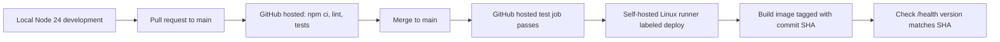

# ITSD 85 CI/CD Lab

This isolated Node.js service demonstrates a small Express API built and tested on Node.js 24, containerized with Docker, and configured for a GitHub Actions self-hosted deployment runner. It lives in `itsd85-lab/` so it does not replace the existing Laravel/Flutter RGV application.

## What this project does

- Serves the ITSD 85 lab homepage at `GET /` with the running `APP_VERSION`.
- Reports `status: "ok"` and the running version from `GET /health`.
- Adds two finite numbers through `GET /api/add?a=2&b=3` and returns JSON.
- Rejects missing, nonnumeric, infinite, and out-of-range inputs with HTTP 400.

## Pipeline diagram



The diagram reflects the checked-in workflow design. No GitHub Actions run or server deployment has been observed yet.

## How to run locally

Requires Node.js 24 and npm.

```bash
npm ci
npm run lint
npm test
npm start
```

The default port is `3000`; override it with `PORT`. The local version defaults to `dev`; set `APP_VERSION` to display another version. In a second terminal:

```bash
curl http://localhost:3000/
curl http://localhost:3000/health
curl 'http://localhost:3000/api/add?a=2&b=3'
curl -i 'http://localhost:3000/api/add?a=x&b=2'
```

## How the deployment works

The workflow runs lint and Node's built-in test runner on GitHub-hosted Ubuntu for pull requests and pushes to `main`. A push to `main` can deploy only after the `test` job succeeds. Deployment targets a self-hosted Linux runner labeled `deploy`, builds `itsd85-app:<commit-sha>`, maps host port `8080` to container port `3000`, and checks that `/health` reports the same SHA. The workflow serializes deployment runs and prunes only dangling images labeled for this lab.

The workflow file is `../.github/workflows/itsd85-lab-ci-cd.yml`. It is configuration only; this repository has not run it on GitHub, and no runner or deployment server has been configured or tested as part of this work.

## Results

### Local verification

The checks below ran locally from `itsd85-lab/`; they are not GitHub Actions or deployment results.

| Command | Result |
|---|---|
| `npm ci` | Passed; installed from the lockfile, 0 reported vulnerabilities |
| `npm run lint` | Passed |
| `npm test` | Passed; 7 tests, 0 failures |
| Local HTTP smoke check | Passed for homepage/version `dev`, `/health`, addition result 5, and invalid-input HTTP 400 |
| `npm audit` | Passed; 0 reported vulnerabilities |

### Required end-to-end evidence (pending)

| Demonstration | Result | Evidence / measurement |
|---|---|---|
| Test A: a valid change passes CI and deploys | Not run | Requires GitHub Actions, protected `main`, runner, and server |
| Test B: a broken change is blocked and not deployed | Not run | Requires an actual test-failing PR and branch protection |
| Test C, Method 1: rollback by revert | Not run | Requires an actual deployment and rollback PR |
| Test C, Method 2: prior image rollback | Not run | Requires retained tagged images on the deployment server |
| Push-to-live / rollback times | Not measured | Do not record until real runs are available |

## Screenshots

No screenshots have been captured. Add real, numbered lab checkpoint screenshots under `docs/screenshots/` after performing the corresponding steps. Do not use mockups as execution evidence.

## Paper

No final paper PDF is included. Create it only after actual deployment and rollback measurements, screenshots, and required submission details are available.

## Guide questions

The eight questions below are reproduced from the provided audit prompt. Confirm wording against the instructor handout before final submission if it differs.

1. **Explain the difference between Continuous Integration, Continuous Delivery, and Continuous Deployment. Which one was built?** Continuous Integration automatically checks changes; Continuous Delivery keeps validated changes deployable but requires a release decision; Continuous Deployment automatically releases every qualifying change. The configured `main` workflow is intended to automatically deploy after tests, so its target is Continuous Deployment. It has not run against a server, so this is a design description, not a claim of demonstrated deployment.
2. **Why does the deploy job use `needs: test`? What would happen without it?** `needs: test` prevents deployment unless lint and tests pass. Without the dependency, the deployment job could start independently and publish an unverified commit.
3. **The server has no public IP address. How was GitHub still able to deploy to it?** A self-hosted runner on the server initiates an outbound connection to GitHub Actions and polls for work; GitHub then sends a job over that established connection. This repository targets a runner labeled `deploy`, but no runner is registered or verified yet.
4. **Why does the workflow use `npm ci` instead of `npm install`?** `npm ci` installs the exact dependency tree recorded in `package-lock.json`, fails if the manifest and lock disagree, and is suited to repeatable CI builds.
5. **Why is the commit ID used as the application version? Give two benefits.** A commit SHA ties the running image to an exact source revision. It makes deployed-version verification auditable and lets an operator identify a prior image for recovery.
6. **Compare rollback Method 1 and Method 2. When would each be selected?** Method 1 reverts the bad change through Git and the normal test/deploy path, preserving repository history and making the correction permanent. Method 2 restarts a retained image tagged with a known-good SHA for urgent recovery; the bad Git change must still be reverted afterward so a later build does not reintroduce it.
7. **What are the security risks of a self-hosted runner on a public repository, and what protections were implemented?** Untrusted pull-request code can steal runner credentials or alter its host if it executes there. This workflow runs PR checks on GitHub-hosted runners and restricts deployment to pushes on `main`, after tests, using a dedicated `deploy` label and read-only repository permissions. Branch protection, runner isolation, and GitHub external-contributor approval settings still require operator verification.
8. **Name one paid CI/CD or hosting product and explain which free tool in this laboratory replaced it.** GitHub Actions can replace a paid hosted CI service for the lab’s test workflow, subject to GitHub’s usage limits. The self-hosted runner also uses the lab server for deployment; that server still has hardware, power, and network costs.

## Troubleshooting

| Problem | Safe checks / recovery |
|---|---|
| SSH public key authentication failure | Check the GitHub account’s registered public key and the SSH agent. Verify the host key through an official source; never paste or print a private key. |
| Missing or unsynchronized `package-lock.json` | Run `npm install` locally to update the lock, review the diff, then verify with `npm ci`. Do not hand-edit lockfile package entries. |
| ESLint unused-variable errors | Remove the unused variable or use it intentionally; do not disable the rule globally to make CI green. |
| Runner offline or wrong labels | Check the runner service state, registration in repository settings, and the exact `self-hosted`, `linux`, `deploy` labels. Keep PR jobs on GitHub-hosted runners. |
| Docker socket permission failure | Check the deployment user's Docker group/service access, then restart the runner service after any group change. Do not make the Docker socket world-writable. |
| Port 8080 already allocated | Inspect the process/container using the port and resolve the conflict deliberately; do not silently publish the app on an undocumented port. |
| Failed health check | Inspect `docker compose ps` and `docker compose logs app`; verify `APP_VERSION`, port mapping, and `/health` before retrying. |
| Missing VirtualBox forwarding | Verify host port `2222` → guest `22` and host `8080` → guest `8080`; check the VM network mode and firewall. |
| Expired runner registration token | Generate a fresh token from GitHub’s runner settings and register it interactively on the server; do not commit or log it. |
| Disk consumed by old images | Review `docker image ls` and disk usage; remove only confirmed unused images. Preserve commit-tagged images needed for rollback. |

## Current verification status

Local tests and lint may be run from this directory. Docker build/runtime, GitHub Actions history, branch protection, server/runner, live health checks, end-to-end demonstrations, screenshots, and Classroom submission remain unverified until performed in those environments.
